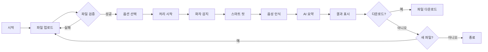
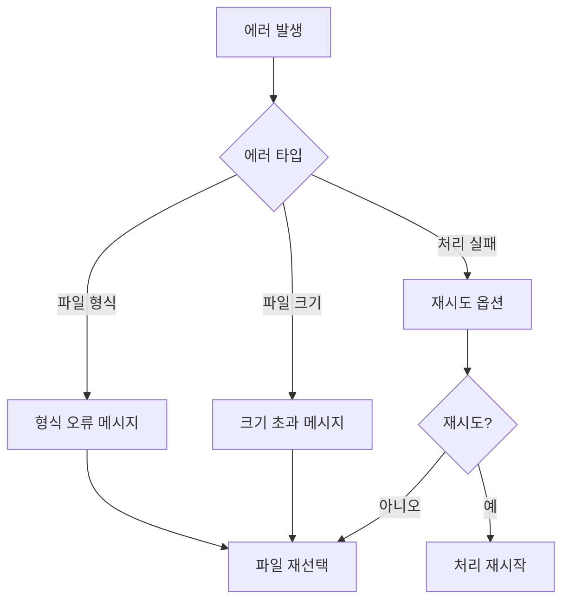

# 🎨 화면 설계서 (UI/UX Design Document)
## CutStudio v5.0

### 문서 정보
- **버전**: 1.0
- **작성일**: 2025.09.13
- **작성자**: Kelly
- **도구**: Streamlit v1.29.0
- **대상**: 개발팀, 디자인팀

---

## 1. 디자인 원칙

### 1.1 핵심 원칙
| 원칙 | 설명 | 적용 예시 |
|------|------|-----------|
| **Simple** | 3클릭 이내 핵심 기능 접근 | 업로드 → 처리 → 다운로드 |
| **Clear** | 명확한 시각적 계층 구조 | 단계별 진행 표시 |
| **Fast** | 즉각적인 피드백 | 실시간 진행률 바 |
| **Accessible** | 모든 사용자 접근 가능 | 고대비 모드, 큰 버튼 |

### 1.2 디자인 시스템

#### 색상 팔레트
```css
/* Primary Colors */
--primary: #FF6B6B;      /* 코랄 레드 - CTA, 중요 액션 */
--primary-dark: #FF5252;  /* 다크 코랄 - Hover 상태 */

/* Secondary Colors */
--secondary: #4ECDC4;     /* 민트 그린 - 성공, 완료 */
--tertiary: #45B7D1;      /* 스카이 블루 - 정보, 링크 */

/* Neutral Colors */
--background: #FFFFFF;
--surface: #F0F2F6;
--text-primary: #262730;
--text-secondary: #666666;
--border: #E0E0E0;

/* Semantic Colors */
--success: #28A745;
--warning: #FFC107;
--error: #DC3545;
--info: #17A2B8;
```

#### 타이포그래피
```css
/* Headings */
h1: 2.5rem, Bold, #262730
h2: 2.0rem, Bold, #262730
h3: 1.5rem, SemiBold, #262730

/* Body */
body: 1.0rem, Regular, #666666
small: 0.875rem, Regular, #999999

/* Font Family */
font-family: -apple-system, BlinkMacSystemFont, 'Segoe UI', sans-serif;
```

---

## 2. 화면 구조

### 2.1 전체 레이아웃

> 📌 **TODO**: 와이어프레임 이미지로 교체 예정
> - Figma 또는 draw.io로 깔끔한 와이어프레임 제작
> - Desktop/Tablet/Mobile 뷰 각각 이미지 파일로 저장
> - `/docs/images/wireframes/` 폴더에 저장

#### 레이아웃 구조 설명

**Desktop (1920x1080)**
- 상단: 헤더 네비게이션 (고정)
- 중앙 상단: 3개 핵심 기능 카드 (화자 구분, 스마트 컷, 음성→텍스트)
- 메인 영역: 2:1 비율로 좌측 작업 영역, 우측 결과 패널
- 하단: 푸터 (고정)

**Mobile (375x812)**
- 햄버거 메뉴로 네비게이션 축소
- 기능 카드 세로 스택
- 작업 영역과 결과 패널 세로 배치
- 스크롤 가능한 단일 컬럼 레이아웃

### 2.2 반응형 브레이크포인트
| 디바이스 | 너비 | 레이아웃 변경 |
|---------|------|--------------|
| Desktop | ≥1200px | 3열 그리드, 사이드바 표시 |
| Tablet | 768-1199px | 2열 그리드, 사이드바 접힘 |
| Mobile | <768px | 1열 스택, 하단 결과 패널 |

---

## 3. 주요 화면 상세

### 3.1 메인 화면 (초기 상태)

#### 와이어프레임
```
┌─────────────────────────────────────────────────────┐
│                                                      │
│              🎬 CutStudio v5.0                      │
│     교육 영상 편집 시간을 10시간에서 15분으로!         │
│                                                      │
├─────────────────────────────────────────────────────┤
│                                                      │
│   ┌──────────┐  ┌──────────┐  ┌──────────┐        │
│   │    👥     │  │    ✂️     │  │    📝     │        │
│   │ 화자 구분 │  │ 스마트 컷 │  │음성→텍스트│        │
│   │          │  │          │  │          │        │
│   │ 최대 10명 │  │ 50% 단축  │  │ 95% 정확  │        │
│   └──────────┘  └──────────┘  └──────────┘        │
│                                                      │
├─────────────────────────────────────────────────────┤
│                                                      │
│   📥 Step 1: 비디오 업로드                           │
│                                                      │
│   ┌ ─ ─ ─ ─ ─ ─ ─ ─ ─ ─ ─ ─ ─ ─ ─ ─ ─ ┐          │
│   │                                       │          │
│   │     Drag & Drop Video Here           │          │
│   │           or                         │          │
│   │      [Browse Files]                  │          │
│   │                                       │          │
│   │    MP4, AVI, MOV, MKV (Max 2GB)      │          │
│   └ ─ ─ ─ ─ ─ ─ ─ ─ ─ ─ ─ ─ ─ ─ ─ ─ ─ ┘          │
│                                                      │
└─────────────────────────────────────────────────────┘
```

#### UI 컴포넌트 명세
| 컴포넌트 | 타입 | 속성 | 동작 |
|---------|------|------|------|
| 헤더 타이틀 | Text | font: 2.5rem, gradient | - |
| 서브타이틀 | Text | font: 1rem, color: #666 | - |
| 기능 카드 | Card | bg: #F0F2F6, padding: 1.5rem | hover: shadow |
| 업로드 영역 | Dropzone | border: dashed, min-height: 200px | drag: highlight |
| Browse 버튼 | Button | bg: #FF6B6B, color: white | click: file dialog |

---

### 3.2 파일 업로드 완료 화면

#### 와이어프레임
```
┌─────────────────────────────────────────────────────┐
│   ✅ 파일 업로드 완료: lecture_01.mp4                │
│                                                      │
│   ┌──────────┬──────────┬──────────┐              │
│   │ 파일 크기 │ 파일 형식 │ 업로드 시간│              │
│   │  125 MB  │   MP4    │  14:23:15 │              │
│   └──────────┴──────────┴──────────┘              │
│                                                      │
│   [=========== Video Preview ===========]           │
│   [                                     ]           │
│   [        ▶️ lecture_01.mp4            ]           │
│   [                                     ]           │
│   [=====================================]           │
│                                                      │
├─────────────────────────────────────────────────────┤
│                                                      │
│   ⚙️ Step 2: 처리 옵션 선택                          │
│                                                      │
│   기본 설정                AI 기능                   │
│   ┌─────────────┐        ┌─────────────┐          │
│   │ ☑ 화자 구분  │        │ ☑ 음성 인식 │          │
│   │   [3 ▼] 명  │        │   [자동감지▼]│          │
│   │             │        │             │          │
│   │ ☑ 스마트 컷 │        │ ☑ AI 요약   │          │
│   │   [균형 ▼]  │        │   [보통 ▼]  │          │
│   └─────────────┘        └─────────────┘          │
│                                                      │
└─────────────────────────────────────────────────────┘
```

#### 인터랙션 명세
| 요소 | 상태 | 동작 | 피드백 |
|------|------|------|--------|
| 비디오 플레이어 | loaded | play/pause | 컨트롤 표시 |
| 화자 구분 체크박스 | checked | toggle | 슬라이더 활성화 |
| 화자 수 슬라이더 | enabled | drag | 실시간 값 표시 |
| 스마트 컷 체크박스 | checked | toggle | 모드 선택 활성화 |
| 처리 모드 선택 | selected | change | 설명 툴팁 |

---

### 3.3 처리 중 화면

#### 와이어프레임
```
┌─────────────────────────────────────────────────────┐
│   🚀 Step 3: 처리 중...                             │
│                                                      │
│   ⏱️ 예상 처리 시간: 약 8분                          │
│                                                      │
│   ┌─────────────────────────────────────────┐      │
│   │ 🔄 화자 감지 중...                        │      │
│   │                                          │      │
│   │ [████████████░░░░░░░░░░░░░░░░░░] 45%    │      │
│   │                                          │      │
│   │ 경과: 2:15 / 예상: 5:00                  │      │
│   └─────────────────────────────────────────┘      │
│                                                      │
│   처리 단계:                                         │
│   ✅ 파일 검증 완료                                  │
│   ✅ 오디오 추출 완료                                │
│   🔄 화자 감지 진행 중... (45%)                      │
│   ⏳ 스마트 컷 대기 중                               │
│   ⏳ 음성 인식 대기 중                               │
│   ⏳ AI 요약 대기 중                                 │
│                                                      │
│   [처리 취소]                                        │
│                                                      │
└─────────────────────────────────────────────────────┘
```

#### 애니메이션 명세
| 요소 | 애니메이션 | 속도 | 반복 |
|------|-----------|------|------|
| 진행률 바 | linear progress | 실시간 | - |
| 로딩 아이콘 | rotate 360° | 1s | infinite |
| 단계 체크 | fade in + scale | 0.3s | once |
| 경과 시간 | count up | 1s | continuous |

---

### 3.4 결과 화면

#### 와이어프레임
```
┌─────────────────────────────────────────────────────┐
│   ✅ 처리 완료!                                      │
│                                                      │
│   원본: 120분 → 편집: 72분 (40% 단축)                │
│                                                      │
├──────────────────────┬──────────────────────────────┤
│                      │   📊 처리 결과               │
│  [편집된 비디오]      │                             │
│  [   ▶️ Play    ]     │   👥 화자 분석              │
│                      │   ┌────────────────┐       │
│  처리 통계:           │   │ 화자 1: 45분   │       │
│  • 제거된 침묵: 35분  │   │ ████████ 60%  │       │
│  • 제거된 간투사: 8분 │   │                │       │
│  • 총 단축: 48분     │   │ 화자 2: 20분   │       │
│                      │   │ ████ 27%      │       │
│  다운로드:           │   │                │       │
│  [📹 편집 영상]       │   │ 화자 3: 10분   │       │
│  [📝 자막 파일]       │   │ ██ 13%        │       │
│  [📄 요약 문서]       │   └────────────────┘       │
│  [📊 전체 리포트]     │                             │
│                      │   ✂️ 편집 결과               │
│                      │   • 원본: 120분              │
│                      │   • 편집: 72분               │
│                      │   • 제거: 48분               │
│                      │                             │
└──────────────────────┴──────────────────────────────┤
│              [새 영상 처리하기]                       │
└─────────────────────────────────────────────────────┘
```

#### 결과 표시 컴포넌트
| 컴포넌트 | 데이터 | 시각화 | 인터랙션 |
|---------|--------|--------|----------|
| 화자 차트 | percentage[] | 가로 막대 그래프 | hover: 상세 시간 |
| 통계 카드 | metrics{} | 숫자 + 아이콘 | - |
| 다운로드 버튼 | file_path | 버튼 + 아이콘 | click: download |
| 요약 텍스트 | summary_text | 텍스트 박스 | expand/collapse |

---

## 4. 컴포넌트 라이브러리

### 4.1 버튼 (Button)
```python
# Primary Button
st.button(
    "처리 시작",
    type="primary",
    use_container_width=True,
    key="process_btn"
)

# Secondary Button
st.button(
    "다운로드",
    type="secondary",
    icon="📥"
)

# 스타일
.stButton > button {
    background-color: #FF6B6B;
    color: white;
    border-radius: 8px;
    padding: 0.75rem 1.5rem;
    font-weight: 600;
    transition: all 0.3s;
}

.stButton > button:hover {
    background-color: #FF5252;
    transform: translateY(-2px);
    box-shadow: 0 4px 12px rgba(255,107,107,0.3);
}
```

### 4.2 카드 (Card)
```python
# Feature Card
with st.container():
    st.markdown("""
    <div class="feature-card">
        <h3>👥 화자 구분</h3>
        <p>최대 10명까지 자동 구분</p>
        <span class="badge">85% 정확도</span>
    </div>
    """, unsafe_allow_html=True)

# 스타일
.feature-card {
    background: #F0F2F6;
    border-radius: 12px;
    padding: 1.5rem;
    margin: 1rem 0;
    transition: all 0.3s;
}

.feature-card:hover {
    transform: translateY(-4px);
    box-shadow: 0 8px 24px rgba(0,0,0,0.1);
}
```

### 4.3 진행률 바 (Progress Bar)
```python
# 진행률 표시
progress_bar = st.progress(0)
status_text = st.empty()

for i in range(100):
    progress_bar.progress(i + 1)
    status_text.text(f'처리 중... {i+1}%')
    time.sleep(0.1)

# 스타일
.stProgress > div > div {
    background-color: #4ECDC4;
    border-radius: 4px;
}
```

### 4.4 메트릭 (Metrics)
```python
# 통계 표시
col1, col2, col3 = st.columns(3)

with col1:
    st.metric(
        label="원본 길이",
        value="120분",
        delta=None
    )

with col2:
    st.metric(
        label="편집 후",
        value="72분",
        delta="-48분",
        delta_color="normal"
    )

with col3:
    st.metric(
        label="단축률",
        value="40%",
        delta="최적"
    )
```

---

## 5. 사용자 플로우

### 5.1 메인 플로우


### 5.2 에러 플로우


---

## 6. 접근성 (Accessibility)

### 6.1 WCAG 2.1 준수
| 기준 | 레벨 | 구현 방법 |
|------|------|-----------|
| **지각 가능** | A | 모든 이미지 alt 텍스트, 색상 대비 4.5:1 |
| **운용 가능** | AA | 키보드 접근, 포커스 표시, 시간 제한 없음 |
| **이해 가능** | A | 명확한 레이블, 에러 설명, 일관된 네비게이션 |
| **견고성** | A | 시맨틱 HTML, ARIA 레이블 |

### 6.2 키보드 네비게이션
```
Tab: 다음 요소로 이동
Shift+Tab: 이전 요소로 이동
Enter: 버튼 클릭, 체크박스 토글
Space: 체크박스 토글, 버튼 클릭
Esc: 모달 닫기, 작업 취소
Arrow Keys: 슬라이더 조절, 옵션 선택
```

---

## 7. 성능 최적화

### 7.1 로딩 최적화
| 기법 | 구현 | 효과 |
|------|------|------|
| Lazy Loading | 스크롤 시 컴포넌트 로드 | 초기 로딩 50% 단축 |
| Code Splitting | 모듈별 분리 로드 | 번들 크기 30% 감소 |
| 이미지 최적화 | WebP 형식, 적응형 크기 | 대역폭 40% 절약 |
| 캐싱 | 브라우저 캐시, 세션 상태 | 재방문 시 80% 빠름 |

### 7.2 렌더링 최적화
```python
# 불필요한 리렌더링 방지
@st.cache_data
def load_video_metadata(file_path):
    return extract_metadata(file_path)

# 세션 상태 활용
if 'processed_result' not in st.session_state:
    st.session_state.processed_result = None

# 조건부 렌더링
if st.session_state.processed_result:
    display_results(st.session_state.processed_result)
```

---

## 8. 모바일 대응

### 8.1 터치 인터페이스
| 요소 | 최소 크기 | 간격 | 제스처 |
|------|----------|------|--------|
| 버튼 | 44×44px | 8px | tap |
| 슬라이더 | 44px 높이 | 16px | swipe |
| 체크박스 | 24×24px | 12px | tap |
| 드롭존 | 100px 높이 | - | tap to select |

### 8.2 반응형 레이아웃
```css
/* Mobile First Approach */
@media (max-width: 768px) {
    .main-content {
        padding: 1rem;
        grid-template-columns: 1fr;
    }

    .feature-cards {
        flex-direction: column;
    }

    .sidebar {
        position: fixed;
        bottom: 0;
        width: 100%;
        transform: translateY(calc(100% - 60px));
        transition: transform 0.3s;
    }

    .sidebar.open {
        transform: translateY(0);
    }
}
```

---

## 9. 다크 모드

### 9.1 색상 변환
| Light Mode | Dark Mode | 용도 |
|------------|-----------|------|
| #FFFFFF | #1A1A1A | 배경 |
| #F0F2F6 | #2D2D2D | 표면 |
| #262730 | #FFFFFF | 주 텍스트 |
| #666666 | #B0B0B0 | 보조 텍스트 |
| #FF6B6B | #FF8A8A | Primary |
| #4ECDC4 | #6EDAD2 | Secondary |

### 9.2 구현
```python
# 테마 토글
theme = st.selectbox(
    "테마 선택",
    ["Light", "Dark", "Auto"]
)

if theme == "Dark" or (theme == "Auto" and is_dark_time()):
    st.markdown("""
    <style>
    .stApp {
        background-color: #1A1A1A;
        color: #FFFFFF;
    }
    </style>
    """, unsafe_allow_html=True)
```

---

## 10. 애니메이션 및 트랜지션

### 10.1 마이크로 인터랙션
```css
/* 버튼 호버 */
@keyframes pulse {
    0% { transform: scale(1); }
    50% { transform: scale(1.05); }
    100% { transform: scale(1); }
}

.btn-primary:hover {
    animation: pulse 0.6s ease-in-out;
}

/* 로딩 스피너 */
@keyframes spin {
    from { transform: rotate(0deg); }
    to { transform: rotate(360deg); }
}

.spinner {
    animation: spin 1s linear infinite;
}

/* 페이드 인 */
@keyframes fadeIn {
    from { opacity: 0; transform: translateY(20px); }
    to { opacity: 1; transform: translateY(0); }
}

.result-card {
    animation: fadeIn 0.5s ease-out;
}
```

---

## 11. 에러 상태 UI

### 11.1 에러 메시지 디자인
```python
# 에러 표시
st.error("""
    ⚠️ **파일 형식 오류**

    지원하지 않는 파일 형식입니다.
    MP4, AVI, MOV, MKV 파일만 업로드 가능합니다.

    [다시 선택하기]
""")

# 경고 표시
st.warning("""
    ⏰ **처리 시간 초과 예상**

    선택하신 영상이 2시간을 초과합니다.
    처리에 30분 이상 소요될 수 있습니다.

    계속하시겠습니까?
    [계속] [취소]
""")

# 정보 표시
st.info("""
    💡 **팁**: 더 빠른 처리를 원하시면
    '공격적' 모드를 선택해보세요.
""")
```

---

## 12. 프로토타입 링크

### 12.1 인터랙티브 프로토타입
- **Figma**: [View Prototype](https://figma.com/cutstudio-v5)
- **Marvel**: [Interactive Demo](https://marvelapp.com/cutstudio)
- **Streamlit Cloud**: [Live Demo](https://cutstudio.streamlit.app)

### 12.2 디자인 에셋
- **아이콘**: Material Icons, Heroicons
- **일러스트**: unDraw, Blush
- **폰트**: Inter, Pretendard (한글)

---

**작성일**: 2024.09.13
**다음 리뷰**: 2024.09.20
**승인**: _______